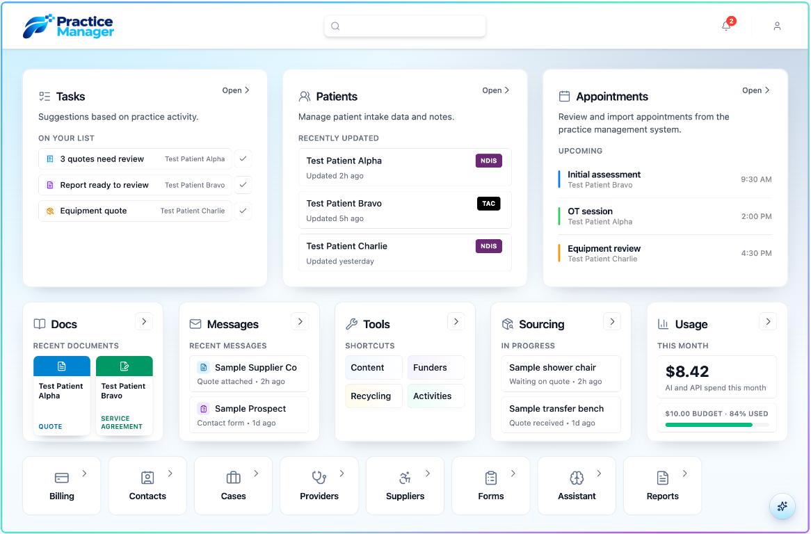

# Practice Manager

Practice Manager is an open-source project for managing the day-to-day work of
health and allied-health practices.



## Project structure

The repository is laid out as an npm-workspaces monorepo. `apps/` holds deployable
processes, `packages/` holds code they import, and `deploy/` holds the packaging and
hosting configuration for each deployment mode.

```text
practice-manager/
├── apps/
│   ├── core/                  # Next.js app: public site, /admin, /api/*
│   │   ├── src/app/
│   │   ├── src/components/
│   │   ├── src/admin-ui/
│   │   ├── src/lib/           # app wiring; business logic lives in packages/
│   │   ├── public/
│   │   ├── content/           # report templates and seeded content files
│   │   ├── middleware.js
│   │   ├── next.config.js
│   │   └── package.json
│   │
│   ├── runtime/               # worker, queue and health service
│   │   ├── src/app/api/       # health, */queue, */worker/run
│   │   ├── src/instrumentation.js  # starts the enabled worker poll loops
│   │   ├── src/lib/           # route auth, request parsing, response shapes
│   │   └── package.json
│   │
│   └── desktop/               # Desktop shell around the core app
│       ├── main/              # Electron main process + the shared launch plan
│       ├── preload/           # contextBridge API surface
│       ├── src/
│       │   ├── preflight.js   # Node, PostgreSQL and schema checks
│       │   ├── setup.js       # create the database, apply the schema
│       │   ├── version.js     # engines range check
│       │   └── cli.js         # preflight / setup / serve commands
│       ├── test/
│       └── package.json
│
├── packages/
│   ├── contracts/             # queue/worker payloads, service auth, plugin manifest
│   ├── db/                    # client, schema, migrations, seeds, RLS policies, scoped connection
│   │   ├── src/
│   │   ├── migrations/
│   │   └── seeds/
│   ├── jobs/                  # worker cycles shared by runtime and desktop inline mode
│   ├── privacy/               # de-identification, egress policy, identity handling
│   ├── practice/              # domain logic: patients, cases, notes, appointments, billing
│   ├── ai/                    # provider clients, model catalog, usage accounting
│   ├── storage/               # adapter interface plus local, volume and object backends
│   ├── identity/              # local single-user, local accounts, OAuth; role model
│   ├── branding/              # default domain, design tokens, private-overlay accessors
│   └── config/                # deployment profile and capability resolution
│       └── src/profiles/      # solo-desktop.js, solo-docker.js, lan.js, cloud.js
│
├── src/private/               # optional operator extension layer (not committed; see below)
│
├── deploy/
│   ├── desktop/               # Electron builder config, signing, update feed
│   ├── docker/                # Dockerfile.core, Dockerfile.runtime, compose.yml, env/
│   ├── lan/                   # TLS termination, backup and restore, upgrade assets
│   └── cloud/                 # Vercel config, Cloud Run job specs, infrastructure defaults
│
├── scripts/                   # development and maintenance scripts
├── test/e2e/                  # cross-app tests; unit tests sit beside their package
├── docs/                      # goals, guides, architecture, deployment, security, roadmap
└── package.json               # npm workspaces, single version and release train
```

Documentation is organised under `docs/`:

- `docs/introduction/` — project goals and concepts
- `docs/user-guide/` — guidance for people using Practice Manager
- `docs/developer-guide/` — development setup and contribution details
- `docs/architecture/` — system design and technical decisions
- `docs/deployment/` — installation and operations guidance, with one page per mode under `docs/deployment/modes/`
- `docs/security/` — security policy and guidance
- `docs/roadmap/` — planned work and project direction
- [`docs/licensing.md`](docs/licensing.md) — licence scope, grant and trademark rule
- [`docs/product-commitments.md`](docs/product-commitments.md) — free vs paid, funding and governance
- [`docs/developer-guide/versioning.md`](docs/developer-guide/versioning.md) — versioning and release process
- [`docs/roadmap/auth.md`](docs/roadmap/auth.md) — admin identity, verified email changes and federated sign-in

## Development

Everything runs from the workspace root:

```bash
npm install          # installs every workspace
npm run build        # production build of apps/core
npm test             # every workspace's test suite
npm run dev          # core on http://localhost:3000
npm run dev:runtime  # worker/queue service on http://localhost:3003
```

`apps/runtime` is only needed when the workers run as their own deployable; a
single-install deployment runs them inside `apps/core` (see [Inline workers](#inline-workers)).

## Deployment modes

Every mode runs the same `apps/core` and `packages/*`; they differ in hosting,
identity, storage and how worker jobs execute. Modes are expressed as profiles in
`packages/config`, not as separate source trees.

| Mode | Core | Workers | Database | Storage | Identity |
|------|------|---------|----------|---------|----------|
| Solo (Desktop) | Electron shell, loopback only | inline | locally installed PostgreSQL | local files | single local operator |
| Solo (Docker) | container | sidecar container or inline | compose PostgreSQL | volume | single local operator |
| LAN | container behind reverse proxy | sidecar container | compose or external PostgreSQL | volume or NAS | local practice accounts |
| Cloud | managed host (e.g. Vercel) | managed one-shot jobs | managed PostgreSQL | object storage | OAuth / admin JWT |

Row-level security is a capability flag rather than an invariant: it is enforced where
more than one principal can reach the database (LAN, Cloud) and skipped where the app
connects as a single local operator.

Solo editions set `PRACTICE_MANAGER_EDITION=solo`. A single practice has no public website
by default, so the root route redirects to `/admin` instead of rendering the marketing home
page; hosted deployments (the default) keep the public site at `/`. The per-domain **Website**
toggle in Admin → Settings → Domains → Features overrides that default: turning it on serves
the domain's website at `/` on a solo install, and turning it off sends `/` to `/admin` on a
hosted one.

## File storage

Every uploaded file has a row in PostgreSQL and bytes that live in one of four backends:
the database (the default), a local directory, Amazon S3 or Google Cloud Storage. The
backend is chosen per practice in Admin → Settings → Domains → Features → File storage;
the bucket, directory and credentials come from the deployment's `FILE_STORAGE_*`
variables.

The Files page (`/admin/files`) lists a practice's whole upload library — patient files
and practice-level files that belong to no patient — and is opt-in per domain
(`filesEnabled`, off by default). Solo (Desktop) and Solo (Docker) typically point
`FILE_STORAGE_DIR` at local or volume storage; Cloud uses `s3` or `gcs` because a
serverless filesystem is ephemeral. Details, key layout and the full variable list:
[docs/file-storage.md](docs/file-storage.md).

## Desktop prerequisites

Solo (Desktop) does not bundle or require Docker. The desktop app expects the operator
to have installed:

- **Node.js** matching `engines` in the relevant `package.json` (currently
  `>=22.13.0 <23 || >=24`).
- **PostgreSQL**, running locally and reachable over a normal connection URL.
- **Redis** only if the operator enables queue-backed workers instead of inline jobs.

`apps/desktop/preflight` probes both prerequisites on launch and reports actionable
failures; `apps/desktop/setup` guides the first run through creating the database,
applying migrations from `packages/db/supabase/migrations`, and saving the connection string.

Both run without Electron, so they can be used over a support call:

```bash
npm run preflight --workspace @practice-manager/desktop          # checklist, exit 1 on failure
npm run preflight --workspace @practice-manager/desktop -- --json # same, for the setup wizard
npm run setup --workspace @practice-manager/desktop              # create the database, apply the schema
```

`setup` creates the database when it is missing and then runs the core app's
`db:init` (32 idempotent schema steps), so `preflight` afterwards passes end to end.

The Electron shell (`npm start --workspace @practice-manager/desktop`) runs the same
preflight before it opens a window: an unsupported Node, an unreachable database or an
unbuilt app each produce a dialog naming the fix instead of a blank window. When the checks
pass it starts the self-contained server on a free loopback port with
`INLINE_WORKERS=true`, waits for `/api/health`, then loads it. `npm run serve --workspace
@practice-manager/desktop` does the same without a window (`-- --once` exits as soon as
health answers), which is how the automated check exercises the launch path.

### Packaging

```bash
npm run build
npm run prepare:standalone --workspace @practice-manager/desktop
npm run package:dir --workspace @practice-manager/desktop    # unpacked app, for testing
npm run package --workspace @practice-manager/desktop        # dmg / zip / nsis / AppImage
```

`prepare:standalone` stages the Next.js standalone server (app code, traced `node_modules`,
static assets, `public/`, report templates) under `deploy/desktop/.stage/standalone`, which
`electron-builder` ships as `resources/app/standalone`. The Electron bundle contains only
the shell — Node.js and PostgreSQL stay operator-supplied and are never bundled.

The packaged app resolves its server from `Contents/Resources/app/standalone`, and finds
`node` through `PATH` or the usual package-manager locations (`/opt/homebrew/bin`,
`/usr/local/bin`, `/usr/bin`), because a Finder launch does not inherit a shell's `PATH`.
Releases still need an application icon and macOS signing/notarisation; local builds are
unsigned.

## Inline workers

A single-install deployment has no second process for the worker service, so the queue
pollers run inside the core app. Set `INLINE_WORKERS=true` plus the flag for each worker
you want, for example:

```bash
INLINE_WORKERS=true
REPORT_WORKER_ENABLED=true
SCRIBE_WORKER_ENABLED=true
EMAIL_WORKER_ENABLED=true
```

Flags take the literal `true` (the workers' own rule); `1` is not accepted. Workers are
inert unless both `INLINE_WORKERS` and their own flag are set. Deployments that point at a
runtime service through `DOMAIN_BACKEND_URL` should leave `INLINE_WORKERS` unset so the web
process does not poll as well. That service is [apps/runtime](apps/runtime/README.md): it
serves the queue, status and worker routes and starts the same poll loops — selected by the
same flags — from `src/instrumentation.js`.

`INLINE_WORKERS=true` also moves *queue writes and reads* into the database. The routes
that would POST to the runtime service now insert the queue row directly, and the status
polls and formal-report load/save read the local tables instead. Enabling the workers and
enabling the bridge cannot drift apart and leave work queued with nothing to consume it.
Without the flag, both halves keep going to `DOMAIN_BACKEND_URL`.

`packages/jobs` also runs as a one-shot drain, which suits a container, a cron entry or a
manual retry:

```bash
npm run jobs:once                          # every enabled worker, one cycle each
node packages/jobs/src/cli.js --only report
```

## AI Providers

AI calls are provider-agnostic: routes and jobs go through `apps/core/src/lib/ai/chat.js`, which
dispatches to whichever vendor is configured instead of hardcoding an endpoint.

| Provider | Key env vars | Default model |
|----------|--------------|---------------|
| OpenAI | `OPENAI_API_KEY` | `gpt-4.1-mini` |
| Claude (Anthropic) | `CLAUDE_API_KEY` or `ANTHROPIC_API_KEY` | `claude-sonnet-4-20250514` |
| Gemini (Google) | `GEMINI_API_KEY` or `GOOGLE_GENERATIVE_AI_API_KEY` | `gemini-2.5-flash` |
| DeepSeek | `DEEPSEEK_API_KEY` | `deepseek-chat` |
| OpenRouter | `OPENROUTER_API_KEY` | `minimax/minimax-m3.1-flash` |

Selection order is per-domain setting -> `AI_PROVIDER` -> OpenAI. Model selection is
per-domain -> provider `*_MODEL` -> `AI_MODEL` -> provider default.
`GET /api/ai/providers/status` reports which providers have keys, and `?validate=true` probes
their `/models` endpoint.

Domain Settings → AI & Defaults can pin a provider and model preset per AI feature (intake
assistant, booking assistant, Quote Writer, and the Admin AI Assistant). A preset stores
`{ provider, tier }` in `domain_settings.aiFeaturePresets`; the model comes from the same
Flagship/Balanced/Value catalog Reporting Settings uses (`ai_provider_model_catalog_v1`, edited in
Admin → Settings → API Integrations). A feature with no preset inherits the domain's AI
vendor/model; the Admin AI Assistant instead falls back to its own assistant settings, which can
still use Google Vertex AI. The domain API key and base URL are only sent to the vendor they were
saved for; other providers use their environment key.

A model id that belongs to another vendor (for example `claude-*` with `openai`) is rejected
before the request is sent. OpenRouter accepts model ids from its full catalog (for example
`anthropic/claude-sonnet-4`) and exposes the live model list in Admin -> Settings -> API Integrations.

## Solo (Docker)

```bash
cp deploy/docker/env/solo.env.example deploy/docker/env/solo.env   # set POSTGRES_PASSWORD and JWT_SECRET
docker compose -f deploy/docker/compose.yml --env-file deploy/docker/env/solo.env up -d --build
curl http://localhost:3000/api/health
```

One application container plus its database. The container runs the queue workers itself
(`INLINE_WORKERS=true`) and serves the solo edition (`PRACTICE_MANAGER_EDITION=solo`), so
`/` opens the admin portal and there is no runtime service to deploy. On start it applies
`npm run db:init` — 29 idempotent steps that create every table a fresh install needs —
before serving. `DATABASE_URL` sets `sslmode=disable` because the database is only
reachable on the compose network and is never published; add TLS before exposing one on a
LAN. The image builds from the repository root (`deploy/docker/Dockerfile.core`), so a
change to `apps/core` or `packages/jobs` rebuilds it.

`npm run db:init --workspace @practice-manager/core` is also the migration path for a
non-container install (desktop). It needs `DATABASE_URL` (or `.env.local`) and exits
non-zero if any step fails.

## Domain branding and extensions

The public distribution ships a single unbranded `default` domain and no customer
names, brand assets or site content. Additional domains and branding are supplied at
build time by an optional **extension layer**: an operator-owned tree whose paths mirror
this repository's layout. The core contains only generic accessors, so a build with no
extension layer succeeds and serves the default domain.

A deployment that does supply branding must make its build fail when the layer is
missing, rather than silently serving the default domain under someone else's
hostname. See [docs/architecture/domain-extension.md](docs/architecture/domain-extension.md).

This is a branding boundary, not a licensing one. The extension layer carries names,
imagery and per-site content; it never carries clinical capability. Per
[LICENSE](LICENSE), the code in this repository is AGPL-3.0 and Asentic retains the right
to offer the software under separate commercial terms. A managed or hosted arrangement
changes who operates the software, not what it can do.

## License

Practice Manager is licensed under the GNU Affero General Public License,
version 3. See [LICENSE](LICENSE) for the license terms and project notice, and
[docs/licensing.md](docs/licensing.md) for the trademark and free/paid policy.
